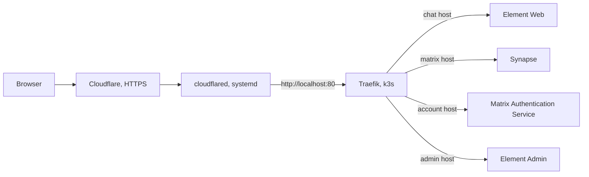

# Architecture

## Request path

`cloudflared` is a systemd service on the host. k3s runs Element Server Suite as
the Helm release `ess` in the namespace `ess`. Traefik, which ships with k3s,
listens on port 80 and routes by hostname. The chart turns off ingress TLS
because Cloudflare ends HTTPS.

The installer and `./element users` reach Matrix over the public matrix URL,
through the tunnel. They authenticate with a compatibility token that
`mas-cli manage issue-compatibility-token` issues for the administrator. They
run `mas-cli` with `kubectl exec` in the MAS pod.

## Code map

The Python code uses the standard library only.

| Path                                                              | Responsibility                                                                                                                          |
| ----------------------------------------------------------------- | --------------------------------------------------------------------------------------------------------------------------------------- |
| [`install`](../install)                                           | Requires root, refuses to start when an installation state file exists, runs `deploy.py install`.                                       |
| [`element`](../element)                                           | Passes its arguments to `deploy.py`.                                                                                                    |
| [`deploy.py`](../deploy.py)                                       | The command line: `install`, `verify`, `check`, `users`. Sets `KUBECONFIG` to the k3s config and puts `/usr/local/bin` first on `PATH`. |
| [`element_chat/config.py`](../element_chat/config.py)             | Loads and validates `deployment.json`, derives the `https://` URLs, loads `organization.json`.                                          |
| [`element_chat/support.py`](../element_chat/support.py)           | Paths and constants, subprocess and HTTP helpers, polling, atomic JSON writes with mode 0600.                                           |
| [`element_chat/chart.py`](../element_chat/chart.py)               | Renders `chart/values.yaml.tmpl` into a temporary file and validates the chart with helm.                                               |
| [`element_chat/installation.py`](../element_chat/installation.py) | The pinned versions, the install phases, and `verify`.                                                                                  |
| [`element_chat/users.py`](../element_chat/users.py)               | The CSV import and its receipt.                                                                                                         |
| [`chart/`](../chart)                                              | The Helm chart. See [Chart](#chart).                                                                                                    |

`support.run` replaces the value after `--password` with `<redacted>` in
messages and errors.

## Installer state

`install` in `installation.py` runs the phases listed in
[Installation](installation.md#run-the-installer). After each phase it appends
the phase name to `completed_phases` in
`/var/lib/element-chat/installation.json`. The `organization` phase also records
the administrator's credentials file and the room IDs it created, so a resumed
run does not create them twice. `users.py` reads those room IDs to join accounts
to rooms.

An import keeps its own receipt, described in [Users](users.md).

## Chart

`chart/` wraps the `matrix-stack` chart from `oci://ghcr.io/element-hq/ess-helm`
(version in [`Chart.yaml`](../chart/Chart.yaml)).
[`values.yaml.tmpl`](../chart/values.yaml.tmpl) holds the values. `chart.py`
fills its `$` placeholders from `deployment.json` and `organization.json`.
[`values.schema.json`](../chart/values.schema.json) requires the top-level
`matrix-stack` sections the template sets.

The values do the following:

- Set the Synapse server name and each component's ingress host.
- Write Element Web's `user-config.json`: brand, Spanish as the default
  language, custom translations, the logo, an immediate SSO redirect, and no
  custom homeserver URLs.
- Disable MatrixRTC.
- Turn off default end-to-end encryption for new rooms.
- Load the Synapse module `ApprovedRoomsOnly` from the `synapse-policy`
  ConfigMap.

The templates in [`chart/templates/`](../chart/templates) add:

- [`assets.yaml`](../chart/templates/assets.yaml): the ConfigMaps
  `element-assets`, `mas-translations` and `synapse-policy`, built from
  `chart/files/`.
- [`force-spanish.yaml`](../chart/templates/force-spanish.yaml): a Traefik
  middleware that sets `Accept-Language: es` on requests to MAS.

| File in `chart/files/`                                              | Used for                                                                                        |
| ------------------------------------------------------------------- | ----------------------------------------------------------------------------------------------- |
| `favicon.ico`, `logo.webp`                                          | Mounted into Element Web.                                                                       |
| `custom-translations.json`                                          | Spanish strings for Element Web.                                                                |
| `mas-es.json`                                                       | The Spanish translation of the MAS pages.                                                       |
| [`room_creation_policy.py`](../chart/files/room_creation_policy.py) | The Synapse module. Only the administrator and Synapse admins may create rooms or invite users. |

`phase_application` also passes the SHA-256 of each asset group to
`helm install` as an annotation on the component that mounts it.
